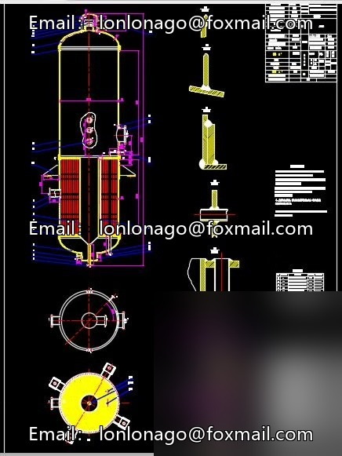
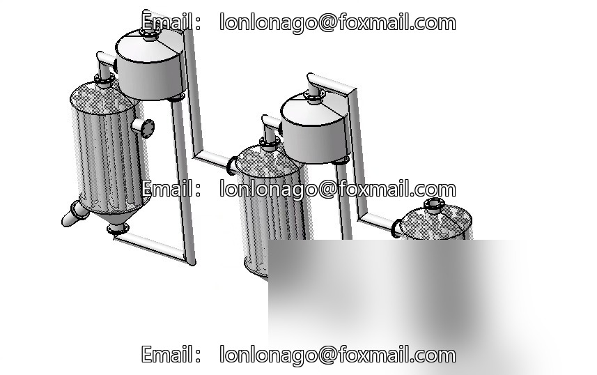
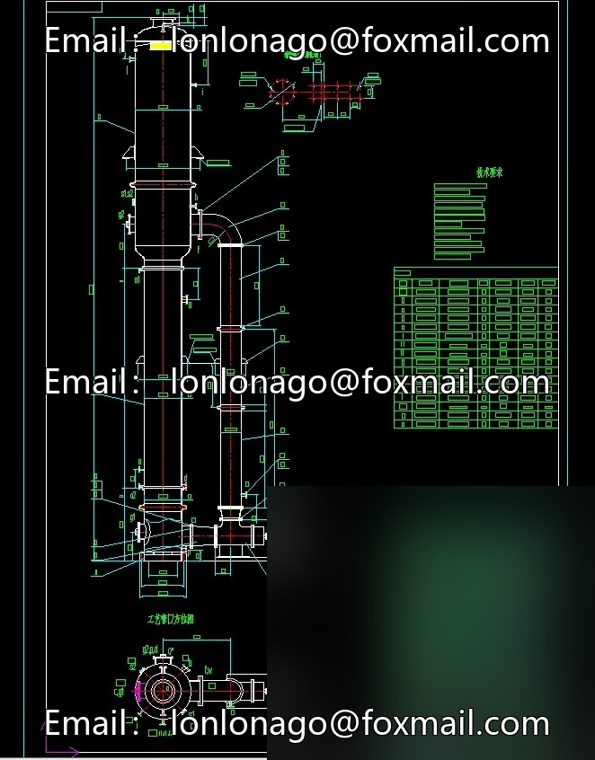
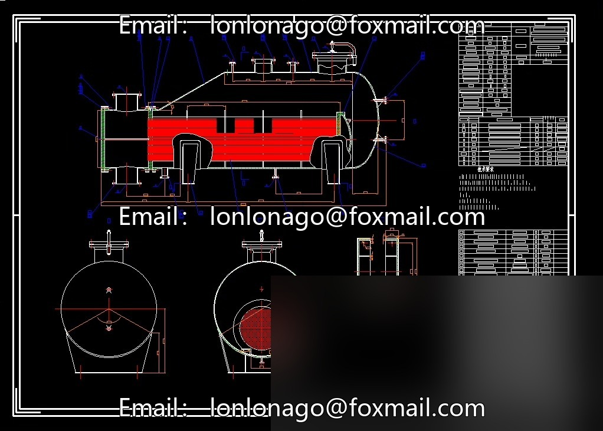

# Evaporator model 3D evaporation 3D evaporator DWG drawing evaporator CAD drawing, evaporator 3D CAD drawing

## Body

The evaporator number model 3D, evaporator DWG drawing, evaporator CAD drawing, evaporator two-dimensional drawing, evaporator three-dimensional drawing, single-efficiency evaporator, three-efficiency evaporator, tubular evaporator and other models, can be opened and edited with catia UG, SolidWorks, etc. A016 also has other various 3D drawings, and services such as modeling and numerical modeling modification, please discuss in detail.

The material includes evaporator modelling, 3D drawings, DWG figures and CAD diagrams, covering two-dimensional, three-dimensional and multi-effect evaporator models, along with related technical requirements and process orientation diagrams.

<!-- AI_ENRICHED -->

## Images

## Payment

Here is a pay link on Stripe ( https://buy.stripe.com/3cs8yP7sY87d0vu9AB ). Please contact me lonlonago@foxmail.com after funding $89, and I will send you a complete data files , thank you!

